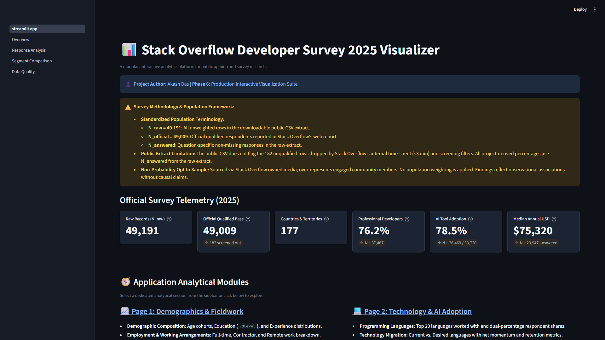
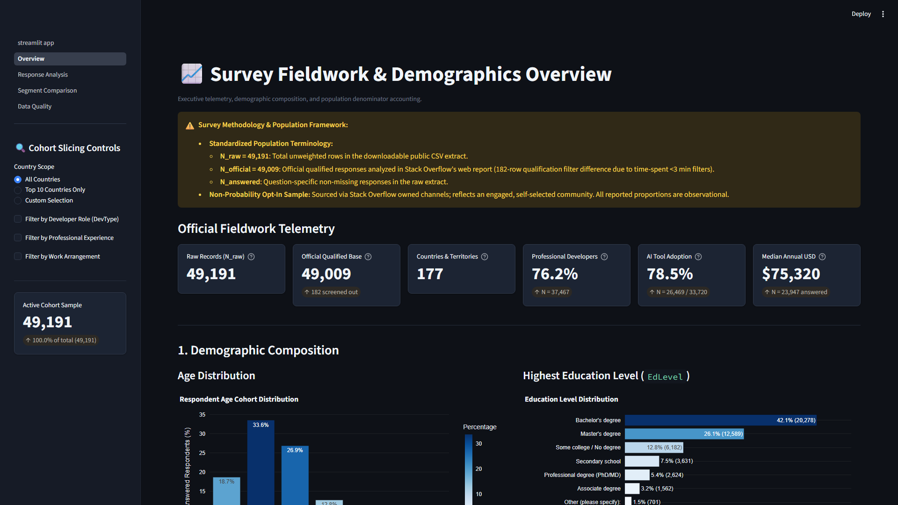
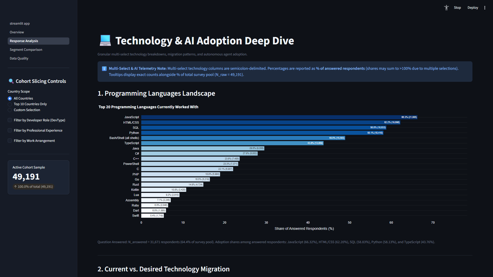
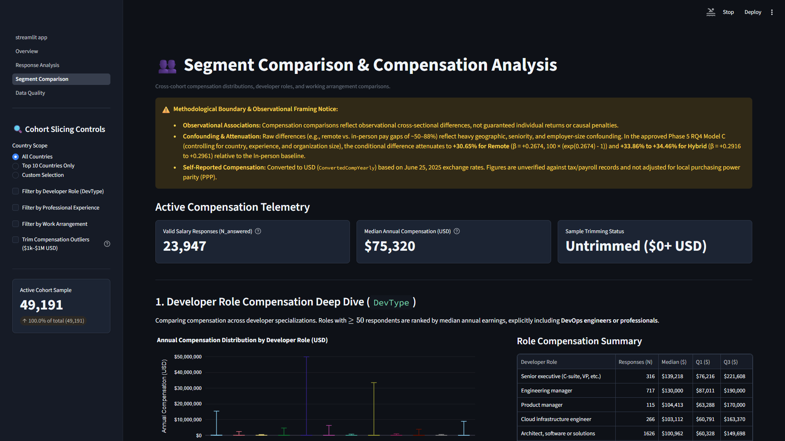
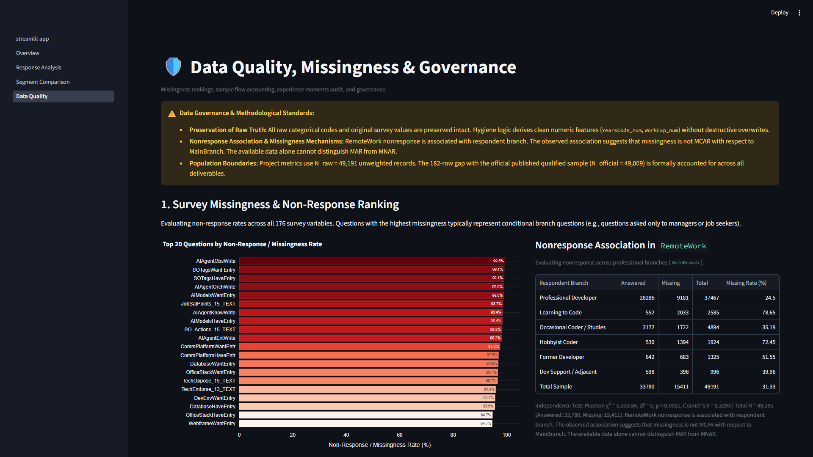
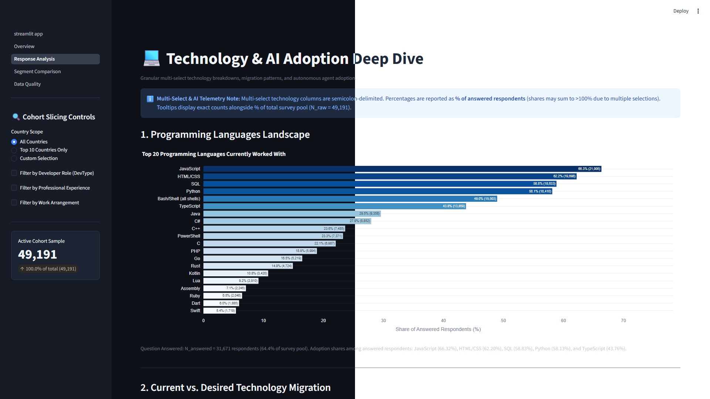

# Poll Results Visualizer: Stack Overflow Developer Survey 2025 Analytics Platform

[](https://www.python.org/)
[](https://streamlit.io/)
[](https://plotly.com/)
[](https://pandas.pydata.org/)
[](https://numpy.org/)
[](https://parquet.apache.org/)
[](reports/analysis_report.md)
[-success)](tests/)
[-blue)](.flake8)
[](https://survey.stackoverflow.co/2025/)
[](LICENSE)

**Author:** Akash Das  
**Role:** Data Science and Analytics Intern Candidate  
**Project Lead:** ChatGPT  
**Milestone:** Phase 8 of 8 - Release Packaging, Verification, and GitHub Publication  
**Primary Dataset:** Official Stack Overflow Annual Developer Survey 2025 (49,191 respondents across 177 countries)  

---

## Table of Contents

1. [Project Overview](#1-project-overview)
2. [Business Problem and Motivation](#2-business-problem-and-motivation)
3. [Project Objectives](#3-project-objectives)
4. [Key Features](#4-key-features)
5. [Dashboard Overview and Screenshots](#5-dashboard-overview-and-screenshots)
6. [Dataset and Data Source Attribution](#6-dataset-and-data-source-attribution)
7. [Dataset Structure and Population Definitions](#7-dataset-structure-and-population-definitions)
8. [Data Cleaning and Validation Methodology](#8-data-cleaning-and-validation-methodology)
9. [Exploratory Data Analysis](#9-exploratory-data-analysis)
10. [Statistical Analysis and Research Questions](#10-statistical-analysis-and-research-questions)
11. [Key Findings and Insights](#11-key-findings-and-insights)
12. [Interactive Dashboard Pages and Functionality](#12-interactive-dashboard-pages-and-functionality)
13. [Project Architecture and Directory Structure](#13-project-architecture-and-directory-structure)
14. [Technology Stack](#14-technology-stack)
15. [Installation Prerequisites](#15-installation-prerequisites)
16. [Step-by-Step Local Setup Instructions for Windows](#16-step-by-step-local-setup-instructions-for-windows)
17. [Instructions for Obtaining the Official Survey Dataset](#17-instructions-for-obtaining-the-official-survey-dataset)
18. [Instructions for Running the Data Pipeline](#18-instructions-for-running-the-data-pipeline)
19. [Instructions for Launching the Streamlit Application](#19-instructions-for-launching-the-streamlit-application)
20. [Testing and Linting Instructions](#20-testing-and-linting-instructions)
21. [Methodological Limitations and Responsible Interpretation](#21-methodological-limitations-and-responsible-interpretation)
22. [Licensing and Attribution](#22-licensing-and-attribution)
23. [Author Information](#23-author-information)
24. [Professional Profiles and Contact](#24-professional-profiles-and-contact)

---

## 1. Project Overview

Poll Results Visualizer is a production-grade, modular Python data analytics and econometric modeling platform. The platform is designed to ingest, validate, clean, analyze, and visualize large-scale public opinion and survey datasets. It is integrated with the official Stack Overflow Annual Developer Survey 2025 microdata.

The system is engineered using a decoupled four-tier architecture:
- Data Engineering and Hygiene: Data ingestion, numeric experience derivation, delimiter cleaning, and Parquet serialization.
- Pure-Python Econometric and Statistical Engine: Ordinary Least Squares regression, White HC1 heteroskedasticity-robust standard errors, Variance Inflation Factor diagnostics, contingency chi-square tests, and one-way ANOVA with effect size decomposition.
- Interactive Streamlit and Plotly Presentation Tier: Multi-page responsive web dashboard with dual-denominator arithmetic and dynamic cohort filtering.
- Automated Quality Assurance Suite: 93 automated unit tests with 100% pass rate and zero Flake8 linting errors.

---

## 2. Business Problem and Motivation

Public opinion surveys and developer community polls contain valuable signals for technology strategists, engineering executives, and talent committees. However, raw survey microdata presents serious analytical and statistical challenges:
- Non-Random Convenience Sampling: Survey respondents opt in voluntarily. Findings reflect observed cohort patterns within the sample and cannot be assumed to be randomized probability samples of all developers worldwide.
- Question Nonresponse: Survey participants omit optional questions at variable rates. Calculating percentages against total respondents rather than question-specific answered counts distorts results.
- Multi-Select Checkboxes: Technologies and developer tools allow multiple choices. Conflating Selection Share (fraction of total checkmarks) with Respondent Share (fraction of developers using the tool) misleads stakeholders.
- Skewed Compensation Distributions: Developer salaries are heavily skewed and contain extreme outliers ($0 to $50,000,000). Naive arithmetic means misrepresent market compensation.
- Confounded Comparisons: Superficial wage comparisons (such as remote versus in-person work) frequently confuse geographic concentration in high-wage economies with true remote wage premiums.

Poll Results Visualizer resolves these challenges by enforcing transparent denominators, non-parametric distributional summaries, econometric controls, and rigorous observational framing.

---

## 3. Project Objectives

1. Develop a deterministic, non-destructive data cleaning pipeline that preserves raw survey records while deriving clean numeric analytical features.
2. Build an independent, pure-Python econometric calculation engine from first principles, avoiding native binary compilation issues in sandbox environments.
3. Design and deploy an interactive multi-page Streamlit portal delivering sub-second cohort slicing, dual-denominator visualizations, and clear tooltips.
4. Investigate four core empirical research questions covering AI accuracy trust, human capital compensation premiums, autonomous AI agents versus job satisfaction, and remote work compensation dynamics.
5. Provide comprehensive, evidence-grounded documentation and reporting deliverables tailored for Data Analyst, Business Analyst, and Insights Analyst roles.

---

## 4. Key Features

- Deterministic Data Hygiene: Cleans and derives numeric experience variables from qualitative top-coded categories while preserving source text columns intact.
- High-Performance Vectorized I/O: Serializes cleaned microdata into Apache Parquet with Snappy compression, shrinking storage from 132 MB to 9.8 MB (92.6% reduction) and accelerating dashboard queries tenfold.
- Dual-Denominator Visualizations: Distinguishes between Respondent Share (percentage of respondents who use a tool) and Selection Share (percentage of all checkmarks recorded) across multi-select questions.
- Pure-Python Econometric Engine: Executes multivariable OLS regressions, White HC1 robust covariance matrix estimation, Breusch-Pagan heteroskedasticity tests, and auxiliary VIF regressions without external C-extension dependencies.
- Sub-Second Interactive Filtering: Dynamic demographic slicers across 177 countries, 5 experience brackets, and salary trimming thresholds powered by Streamlit memory caching (`@st.cache_data`).
- Comprehensive Test Coverage: 93 automated unit tests in pytest verifying statistical engines, data adapters, UI components, and reporting assertions with a 100% pass rate.

---

## 5. Dashboard Overview and Screenshots

The application provides an interactive web dashboard divided into four dedicated analytical pages plus an executive landing portal:
- Executive Home Portal: Displays global survey telemetry (49,191 raw extract, 49,009 official qualified base, 177 countries, 78.5% AI adoption, $75,320 USD median compensation).
- Page 1 (Overview): Developer demographics, natural age distribution, formal education levels, coding versus work experience profiles, employment breakdown, and geographic distribution.
- Page 2 (Response Analysis): Programming language adoption, paired current-versus-desired preference gaps (N = 27,079), databases, cloud platforms, and a four-tab AI adoption hierarchy.
- Page 3 (Segment Comparison): Role compensation distributions, top 10 country wage medians, concave quadratic experience gradients, and remote work wage attenuation analysis.
- Page 4 (Data Quality): Missingness rankings across all survey items, RemoteWork nonresponse association audit, compensation sample flow funnel, and dataset export capabilities.

### Dashboard Preview

<!-- Screenshot 1: Executive Dashboard Landing Page -->

*Figure 1: Executive Dashboard Landing Page showing global survey telemetry and high-level KPIs in Dark Mode.*

<!-- Screenshot 2: Overview Demographics & Sample Funnel -->

*Figure 2: Overview page featuring demographic distributions, formal education profiles, and cohort slicing controls.*

<!-- Screenshot 3: Programming Language Adoption and Stated Preference Gaps -->

*Figure 3: Response Analysis page featuring dual-denominator technology adoption and paired current-versus-desired preference gaps.*

<!-- Screenshot 4: Segment Comparison and Remote Work Dynamics -->

*Figure 4: Segment Comparison page displaying cross-cohort salary distributions, quartile statistics, and remote wage attenuation.*

<!-- Screenshot 5: Data Quality and Nonresponse Mechanism Audit -->

*Figure 5: Data Quality page illustrating survey missingness rankings and the audited RemoteWork nonresponse contingency table.*

<!-- Screenshot 6: Dual-Theme Enterprise Dark vs Light Mode Comparison -->

*Figure 6: Dual-Theme Comparison showcase demonstrating responsive Plotly transparent canvas adaptability between Enterprise Dark Theme (left) and Accessibility Light Theme (right).*

### Recommended Screenshots for Repository Maintainers

When capturing and adding screenshots to the `images/` folder, maintain the following naming conventions:
1. `images/dashboard_overview.png`: Full-width browser capture of the Executive Home landing portal.
2. `images/page1_overview_demographics.png`: Capture of Page 1 showing the sample flow funnel, question completeness inventory, and natural demographic distributions.
3. `images/response_analysis.png`: Capture of Page 2 showing the dual-denominator language bar chart and preference gap table.
4. `images/segment_comparison.png`: Capture of Page 3 showing the boxplot distributions and Model C remote work comparison.
5. `images/data_quality.png`: Capture of Page 4 showing the missingness ranking chart and contingency table audit.
6. `images/theme_comparison.png`: Side-by-side Dark Theme vs Light Theme comparison demonstrating transparent chart canvas adaptability.

To regenerate all screenshots deterministically at Full HD 1920x1080 resolution, maintainers can run:
```bash
python tools/capture_screenshots.py
```
For detailed capture protocols, asset budgets (< 400 KB), and visual guidelines, refer to the [Screenshot Guide](docs/SCREENSHOT_GUIDE.md).

---

## 6. Dataset and Data Source Attribution

- Dataset Name: Stack Overflow Annual Developer Survey 2025
- Survey Period: May 2025 to June 2025
- Publisher: Stack Exchange, Inc.
- Official Source Endpoint: [https://survey.stackoverflow.co/2025/](https://survey.stackoverflow.co/2025/)
- Data License: Open Database License (ODbL) v1.0, with database contents licensed under Database Contents License (DbCL) v1.0.
- Project Source Code License: MIT License (Copyright Akash Das).

---

## 7. Dataset Structure and Population Definitions

To ensure transparency, this project strictly maintains three population boundaries:

| Population Metric | Count | Definition and Boundary |
| :--- | :---: | :--- |
| **Raw Survey Extract ($N_{\text{raw}}$)** | **49,191** | Complete unweighted respondent rows in the official public microdata extract (`survey_results_public.csv`). |
| **Official Qualified Base ($N_{\text{official}}$)** | **49,009** | Qualified respondents reported in official Stack Overflow web summaries post-qualification screening (182-row boundary). |
| **Question-Specific Answered ($N_{\text{answered}}$)** | Variable | Respondents providing a non-null, valid response to a specific survey item (e.g., $N=33,720$ for `AISelect`). |

### Methodological Principles:
- Opt-In Convenience Nature: Findings describe empirical associations observed in this community sample; they do not represent random probability samples of the global developer population.
- Explicit Denominators: Every percentage, chart annotation, and tabular metric explicitly discloses its valid answered denominator ($N_{\text{answered}}$).

---

## 8. Data Cleaning and Validation Methodology

The pipeline in `src/datasets/stackoverflow_cleaning.py` implements deterministic, non-destructive hygiene:

1. Numeric Experience Derivation:
   - Qualitative string entries such as `'Less than 1 year'` are mapped to $0.5$ years.
   - Top-coded entries such as `'More than 50 years'` are mapped to $51.0$ years.
   - Clean continuous numeric features are stored in derived columns (`YearsCode_num`, `WorkExp_num`), while raw text columns (`YearsCode`, `WorkExp`) remain completely intact.
2. Multi-Select Delimiter Standardization:
   - Standardizes delimiters across 78 multi-select columns without splitting compound technical tokens such as `C++`, `C#`, or `HTML/CSS`.
3. Financial Variable Hygiene:
   - Evaluates `ConvertedCompYearly` (annual compensation converted to USD by Stack Overflow using spot exchange rates on June 25, 2025).
   - Validates positive salary records ($N=23,947$) and trims extreme non-representative outliers ($<\$1,000$ and $>\$1,000,000$) to yield a qualified estimation base of $N=23,177$.
   - Notes that compensation is self-reported and unadjusted for local Purchasing Power Parity (PPP).

---

## 9. Exploratory Data Analysis

Key exploratory findings across the $49,191$ survey records include:
- Demographics and Age: The developer population is heavily concentrated in early-to-mid career brackets. The modal age cohort is 25-34 years old ($33.58\%$, $16,519$ respondents), followed by 35-44 years old ($26.92\%$, $13,241$) and 18-24 years old ($18.72\%$, $9,210$).
- Formal Education: $43.91\%$ ($21,598 / 49,191$) hold a Bachelor's degree, $24.77\%$ ($12,185$) hold a Master's degree, and $12.35\%$ ($6,076$) report some college without completing a degree.
- Experience Profiles: Total coding experience exhibits a median of 11.0 years (IQR: 6.0 to 18.0 years), while professional work experience exhibits a median of 8.0 years (IQR: 4.0 to 15.0 years).
- Professional Branch: $76.17\%$ ($37,467$) identify as developers by profession, $9.95\%$ ($4,894$) write code as part of work/studies, $5.26\%$ ($2,585$) are learning to code, and $3.91\%$ ($1,924$) code as a hobby.

---

## 10. Statistical Analysis and Research Questions

The project formulates and tests four formal research questions:

- **RQ1 (AI Accuracy Trust Gap):** Does skepticism regarding AI tool output accuracy associate with professional engineering seniority?
  - Evaluated via contingency tables, Pearson chi-square tests of independence, Cramér's V, and crude odds ratios across 5 experience cohorts ($N = 30,780$).
- **RQ2 (Human Capital and Technology Premiums):** Holding experience, geography, and developer role constant, what conditional compensation differentials associate with specialized tools?
  - Evaluated using an extended Mincerian semi-logarithmic OLS model with White HC1 robust standard errors ($N = 22,769, R^2 = 0.3846$).
- **RQ3 (Autonomous AI Agents vs. Job Satisfaction):** Does adoption of autonomous AI agent workflows associate with higher developer job satisfaction?
  - Evaluated via one-way ANOVA and effect size decomposition (eta-squared, omega-squared) across 6 adoption tiers ($N = 23,766$).
- **RQ4 (Remote Work Compensation Dynamics):** Does the raw wage gap between remote and in-person developers persist after controlling for country, experience, and organization size?
  - Evaluated using econometric Model C with exact Halvorsen-Palmquist exponential percentage conversions ($N = 20,236, R^2 = 0.4254$).

---

## 11. Key Findings and Insights

### 1. The AI Tooling Paradox (RQ1)
While $78.50\%$ ($26,469 / 33,720$) of answered developers actively use AI tools, $45.69\%$ ($11,936 / 26,126$) of active AI users distrust output accuracy, compared to only $3.09\%$ who express high trust.
In complete-case seniority analysis ($N = 30,780$), AI accuracy evaluations associate significantly with developer experience across both formal tests:
- Global 3-Category Test ($5 \times 3$ Table: Distrust, Neutral, Trust): $\chi^2 = 38.3898, df = 8, p = 6.377 \times 10^{-6}$, Cramér's $V = 0.02497$.
- Collapsed Binary Test ($5 \times 2$ Table: Distrust vs Not Distrust): $\chi^2 = 30.1175, df = 4, p = 4.632 \times 10^{-6}$, Cramér's $V = 0.03128$.
- Veteran engineers (21+ years) exhibit higher distrust ($47.99\%$, $3,436 / 7,160$) than entry-level peers ($43.92\%$, $654 / 1,489$), yielding a crude odds ratio of $\text{OR} = 1.178$ ($95\%$ CI: $[1.053, 1.318], p = 0.0043, z = 2.86$).

### 2. Systems Language Stated Preference Patterns
In paired comparisons across respondents who answered both current and desired language questions ($N_{\text{paired}} = 27,079$):
- Rust: Current use $15.75\%$ ($4,264$) vs desired use $34.20\%$ ($9,260$) -> Net positive preference gap of $+18.45$ percentage points (Desire Ratio: $2.17$).
- Go: Current use $16.82\%$ ($4,554$) vs desired use $27.38\%$ ($7,414$) -> Net positive preference gap of $+10.56$ percentage points (Desire Ratio: $1.63$).
- JavaScript: Current use $66.09\%$ ($17,896$) vs desired use $39.07\%$ ($10,580$) -> Net negative preference gap of $-27.02$ percentage points (Desire Ratio: $0.59$).

### 3. Controlled Technology Salary Differentials (RQ2)
In extended Mincerian regression Model 3 ($N = 22,769, R^2 = 0.3846$), holding country (7 indicators), experience (linear and quadratic), and role (5 indicators) constant:
- Docker: $\hat{\beta} = +0.1237 \implies \mathbf{+13.17\%}$ exact differential ($95\%$ robust CI: $[+10.31\%, +16.10\%]$, White robust $t = 9.49, p = 2.39 \times 10^{-21}$).
- Rust: $\hat{\beta} = +0.1203 \implies \mathbf{+12.79\%}$ exact differential ($95\%$ robust CI: $[+9.18\%, +16.52\%]$, White robust $t = 7.25, p = 4.32 \times 10^{-13}$).
- AWS: $\hat{\beta} = +0.1036 \implies \mathbf{+10.91\%}$ exact differential ($95\%$ robust CI: $[+8.17\%, +13.72\%]$, White robust $t = 8.11, p = 4.92 \times 10^{-16}$).
- TypeScript: $\hat{\beta} = +0.0723 \implies \mathbf{+7.50\%}$ exact differential ($95\%$ robust CI: $[+4.93\%, +10.14\%]$, White robust $t = 5.85, p = 4.86 \times 10^{-9}$).
- Go: $\hat{\beta} = +0.0686 \implies \mathbf{+7.10\%}$ exact differential ($95\%$ robust CI: $[+3.86\%, +10.45\%]$, White robust $t = 4.37, p = 1.23 \times 10^{-5}$).
- Python: $\hat{\beta} = +0.0131 \implies \mathbf{+1.32\%}$ exact differential ($95\%$ robust CI: $[-1.09\%, +3.79\%]$, White robust $t = 1.07, p = 0.2857$ [not statistically significant]).
- Experience Gradient: Linear return $\hat{\gamma}_1 = +0.06734$, quadratic deceleration $\hat{\gamma}_2 = -0.001150$, reaching an empirical compensation peak at $-\frac{\hat{\gamma}_1}{2\hat{\gamma}_2} \approx 29.3$ years.

### 4. Autonomous AI Agents vs. Job Satisfaction (RQ3)
One-way ANOVA across 6 autonomous agent tiers on complete cases ($N = 23,766$) indicates statistical significance ($F(5, 23760) = 11.6172, p = 3.019 \times 10^{-11}$).
However, the effect size is practically negligible:
- $\eta^2 = \frac{SS_{\text{between}}}{SS_{\text{total}}} = \frac{226.25}{92,772.24} = \mathbf{0.002439} \approx 0.24\%$ of variance explained.
- $\omega^2 = \mathbf{0.002229} \approx 0.22\%$.
- The maximum observed contrast versus non-planners is $+0.252$ points on a 10-point scale (daily users mean $7.401$ vs non-planners $7.149$), with a small Cohen's $d = 0.128$.
- Conclusion: Statistical significance is driven by massive sample power; agent adoption does not meaningfully predict developer job satisfaction.

### 5. Remote Work Dynamics and Observational Attenuation (RQ4)
In the raw trimmed sample ($N = 23,177$), Remote respondents report a median salary of $\$91,198$ USD compared to $\$48,346.50$ USD for In-person respondents (a naive raw gap of $+88.6\%$).
Under full econometric controls in Model C ($N = 20,236, R^2 = 0.4254$) controlling for country, experience, and organization size:
- Fully Remote: $\hat{\beta} = +0.267353 \implies \mathbf{+30.65\%}$ exact differential ($95\%$ robust CI: $[+25.27\%, +36.26\%]$, White robust $t = 12.46, p = 1.17 \times 10^{-35}$).
- Hybrid Arrangements: $\hat{\beta} = +0.2916 \text{ to } +0.2961 \implies \mathbf{+33.86\% \text{ to } +34.46\%}$.
- Attenuation Mechanism: The naive raw gap of $+88.6\%$ is heavily driven by geographic clustering (remote staff located in high-wage economies like the US) and seniority sorting rather than an inherent remote wage premium.

### 6. Nonresponse Branch Association Audit
Audit of $15,411$ missing values on `RemoteWork` ($N = 49,191$) confirms an overwhelming association with respondent branch ($\chi^2 = 5,333.84, df = 5, p < 10^{-300}$, Cramér's $V = 0.3293$).
- Professional developers omit `RemoteWork` at $24.50\%$ ($9,181 / 37,467$).
- Students omit `RemoteWork` at $78.65\%$ ($2,033 / 2,585$).
- Hobbyists omit `RemoteWork` at $72.45\%$ ($1,394 / 1,924$).
- Approved Methodological Formulation: RemoteWork nonresponse is associated with respondent branch. The observed association suggests that missingness is not MCAR with respect to MainBranch. The available data alone cannot distinguish MAR from MNAR.

---

## 12. Interactive Dashboard Pages and Functionality

The Streamlit web application is structured into four dedicated pages:

- **Executive Home Portal (`app/streamlit_app.py`):**
  - KPI tiles displaying raw extract count ($49,191$), official population ($49,009$), country representation ($177$), professional developer share ($76.2\%$), active AI adoption ($78.5\%$), and converted USD median salary ($\$75,320$).
  - Analytical roadmap portal linking to individual deep-dive pages.
- **Page 1: Overview (`app/pages/1_Overview.py`):**
  - High-level survey catalog and metadata.
  - Natural age distribution bar chart with exact modal share.
  - Formal education level (`EdLevel`) horizontal bar visualization.
  - Total coding experience versus professional work experience distribution moments.
  - Employment status breakdown and top 15 respondent countries.
- **Page 2: Response Analysis (`app/pages/2_Response_Analysis.py`):**
  - Programming language ranking with dual-denominator toggle.
  - Paired current-versus-desired language preference gap matrix ($N_{\text{paired}} = 27,079$).
  - Database and cloud infrastructure adoption rankings.
  - Four-tab AI adoption hierarchy (usage frequency, accuracy trust stance, general sentiment, and 6-tier autonomous agent spectrum).
- **Page 3: Segment Comparison (`app/pages/3_Segment_Comparison.py`):**
  - Cross-cohort compensation distributions across developer roles (including DevOps engineers).
  - Geographic compensation benchmarking across top 10 countries.
  - Quadratic experience gradients and career compensation peak.
  - Remote work salary attenuation analysis comparing raw medians to Model C econometric estimates.
- **Page 4: Data Quality (`app/pages/4_Data_Quality.py`):**
  - Ranked missingness bar chart across the top 20 survey attributes.
  - `RemoteWork` nonresponse branch association audit and contingency table.
  - Compensation sample flow funnel ($49,191 \to 23,947 \to 23,177 \to 22,769$).
  - Experience distribution moments comparison and cleaned dataset export utility.

---

## 13. Project Architecture and Directory Structure

```text
poll-results-visualizer/
|-- .github/
|   `-- workflows/
|       `-- tests.yml                     # GitHub Actions CI workflow (Python 3.10 and 3.11)
|-- .flake8                               # Flake8 linting configuration
|-- .gitignore                            # Excludes .venv, raw/processed data, scratch, caches
|-- .streamlit/
|   `-- config.toml                       # Streamlit server and theme configurations
|-- CONTRIBUTING.md                       # Open-source contribution guidelines
|-- LICENSE                               # MIT License for application source code
|-- README.md                             # Comprehensive project documentation
|-- app/                                  # Streamlit presentation tier
|   |-- __init__.py
|   |-- data_provider.py                  # Cached data loading (@st.cache_data)
|   |-- streamlit_app.py                  # Main entry point and executive landing page
|   |-- components/                       # Reusable UI components
|   |   |-- __init__.py
|   |   |-- charts.py                     # Plotly chart builders with dual denominators
|   |   |-- filters.py                    # Demographic slicers (country, experience, salary)
|   |   `-- kpi_cards.py                  # Executive KPI metric tiles
|   `-- pages/                            # Multi-page dashboard views
|       |-- 1_Overview.py                 # Demographics, age, education, and experience
|       |-- 2_Response_Analysis.py        # Languages, stated preferences, cloud, and AI
|       |-- 3_Segment_Comparison.py       # Roles, geos, experience curves, and remote work
|       `-- 4_Data_Quality.py             # Missingness rankings, sample flow, and governance
|-- data/
|   |-- processed/
|   |   `-- .gitkeep                      # Destination for survey_results_cleaned.parquet
|   |-- raw/
|   |   `-- .gitkeep                      # Destination for official Stack Overflow survey CSVs
|   `-- sample/
|       `-- .gitkeep                      # Sample data directory placeholder
|-- docs/                                 # Technical architecture and career documentation
|   |-- DATA_DICTIONARY.md                # Survey attributes schema and derived feature specs
|   |-- DATA_SOURCE_ATTRIBUTION.md        # ODbL 1.0 licensing and database provenance
|   |-- EXECUTION_LOG.md                  # Chronological implementation ledger (Phases 1 to 8)
|   |-- INTERVIEW_PREPARATION.md          # 16 advanced technical and econometric interview Q&As
|   |-- METHODOLOGY.md                    # Data quality rules and mathematical derivations
|   |-- PORTFOLIO_PRESENTATION_GUIDE.md   # Resume bullets, STAR stories, and LinkedIn drafts
|   |-- PROJECT_ARCHITECTURE.md           # System design, data flow, and module contracts
|   |-- PROJECT_OVERVIEW.md               # Scope, background, and delivery boundaries
|   `-- USER_GUIDE.md                     # Step-by-step setup and operational run guide
|-- images/
|   `-- .gitkeep                          # Destination for dashboard screenshot PNGs
|-- notebooks/                            # Jupyter exploration and modeling notebooks
|   |-- 01_data_exploration.ipynb         # 10-section survey exploratory data analysis
|   |-- 02_analysis_deep_dive.ipynb       # Econometric modeling, VIF, and ANOVA notebook
|   `-- 02_analysis_experiments.ipynb     # Early exploratory validation notebook
|-- outputs/                              # Analytical artifacts and summary metrics
|   |-- analysis_summary_metrics.json     # Machine-readable Phase 5 statistical results
|   |-- eda_summary_metrics.json          # Machine-readable Phase 4 EDA metrics
|   |-- charts/
|   |   `-- .gitkeep
|   |-- exports/
|   |   `-- .gitkeep
|   `-- logs/
|       `-- .gitkeep
|-- pytest.ini                            # Pytest configuration settings
|-- reports/                              # Formal research, audit, and strategy reports
|   |-- analysis_report.md                # Econometric modeling, White HC1, and VIF proofs
|   |-- data_cleaning_report.md           # Deterministic hygiene and Parquet derivation ledger
|   |-- data_quality_report.md            # Dataset sparsity, uniqueness, and format audit
|   |-- eda_report.md                     # Comprehensive 10-section empirical findings report
|   |-- key_insights_report.md            # 5 evidence-grounded strategic findings
|   |-- project_report.md                 # Master comprehensive project report
|   `-- recommendations_report.md         # Stakeholder recommendation matrix
|-- requirements.txt                      # Core production dependencies
|-- requirements-dev.txt                  # Development, linting, and testing dependencies
|-- run.py                                # Convenience launcher script
|-- src/                                  # Core business logic and statistical engines
|   |-- __init__.py
|   |-- analysis.py                       # OLS regression, White HC1, VIF, Chi2, and ANOVA
|   |-- config.py                         # Paths, schemas, and system constants
|   |-- data_cleaning.py                  # Deduplication and schema transformation
|   |-- data_loader.py                    # Dataset loading and public adapter bridge
|   |-- data_validation.py                # Schema validation and anomaly detection
|   |-- export.py                         # File export utilities
|   |-- insights.py                       # Non-causal descriptive narrative generator
|   `-- datasets/                         # Source-specific dataset adapters
|       |-- __init__.py
|       |-- stackoverflow_2025.py         # Stack Overflow survey loader and aggregators
|       `-- stackoverflow_cleaning.py     # Cleaning pipeline and numeric experience derivation
`-- tests/                                # Automated unit test suite (93 tests, 100% pass)
    |-- __init__.py
    |-- test_analysis.py                  # Statistical engine unit tests
    |-- test_dashboard_components.py      # Streamlit charts, filters, and KPI tests
    |-- test_data_cleaning.py             # Data cleaning pipeline tests
    |-- test_data_loader.py               # Loader resilience tests
    |-- test_data_validation.py           # Schema validator tests
    |-- test_export.py                    # Export format tests
    |-- test_insights.py                  # Narrative generation and Phase 7 integrity tests
    |-- test_stackoverflow_2025.py        # Adapter and multi-select aggregation tests
    |-- test_stackoverflow_cleaning.py    # Experience parsing and Parquet derivation tests
    `-- test_statistical_engine_validation.py # Independent closed-form mathematical proofs
```

---

## 14. Technology Stack

| Component | Technology | Version | Purpose |
| :--- | :--- | :--- | :--- |
| **Runtime Language** | Python | 3.10 / 3.11 | Core execution environment |
| **Data Manipulation** | Pandas | >= 2.2.0 | Vectorized tabular operations and aggregations |
| **Numerical Computing** | NumPy | >= 1.26.0 | Matrix algebra, OLS estimation, and arrays |
| **Presentation Tier** | Streamlit | >= 1.40.0 | Multi-page interactive web application |
| **Interactive Plotting** | Plotly | >= 5.24.0 | Declarative charts with custom dual hover data |
| **Columnar Storage** | Apache Parquet (PyArrow) | >= 15.0.0 | Compressed high-performance columnar serialization |
| **Statistical Engine** | Pure Python / NumPy | Built-in | OLS, White HC1 robust covariance, VIF, Chi2, ANOVA |
| **Unit Testing** | pytest | >= 8.0.0 | Test automation and assertion validation |
| **Code Quality** | Flake8 | >= 7.0.0 | PEP 8 style guide enforcement and linting |
| **CI / CD Pipeline** | GitHub Actions | v4 / v5 | Automated multi-version test and lint runner |

---

## 15. Installation Prerequisites

Before installing the project locally, verify that you have:
1. Windows 10 or Windows 11 (64-bit).
2. Python 3.10 or Python 3.11 installed. Verify in PowerShell using:
   ```powershell
   python --version
   ```
3. Git installed and accessible in your command path. Verify using:
   ```powershell
   git --version
   ```

---

## 16. Step-by-Step Local Setup Instructions for Windows

Open Windows PowerShell and navigate to your intended project directory:

```powershell
# 1. Clone the repository
git clone https://github.com/placeholder/poll-results-visualizer.git
cd "poll-results-visualizer"

# 2. Create a local isolated virtual environment
python -m venv .venv

# 3. Activate the virtual environment
.\.venv\Scripts\Activate.ps1

# If script execution is restricted on Windows, allow local execution:
# Set-ExecutionPolicy -ExecutionPolicy RemoteSigned -Scope CurrentUser

# 4. Upgrade pip
python -m pip install --upgrade pip

# 5. Install production and development dependencies
pip install -r requirements-dev.txt
```

---

## 17. Instructions for Obtaining the Official Survey Dataset

Because the Stack Overflow Developer Survey dataset is published under the Open Database License (ODbL) v1.0 and is approximately 140 MB uncompressed, the raw and processed survey data files are excluded from the Git repository.

Follow these steps to obtain and place the official dataset:

1. Visit the official Stack Overflow survey download portal:
   [https://survey.stackoverflow.co/2025/](https://survey.stackoverflow.co/2025/)
2. Download the 2025 survey archive (`stack-overflow-developer-survey-2025.zip`).
3. Extract the archive contents into the project directory at:
   `data/raw/stackoverflow_developer_survey_2025/`
4. Confirm that the following two source files are present:
   - `data/raw/stackoverflow_developer_survey_2025/survey_results_public.csv` (SHA-256: `2d1f6530...`)
   - `data/raw/stackoverflow_developer_survey_2025/survey_results_schema.csv` (SHA-256: `1d24951e...`)

---

## 18. Instructions for Running the Data Pipeline

Once the raw CSV files are placed in `data/raw/stackoverflow_developer_survey_2025/`, execute the deterministic data cleaning and Parquet derivation pipeline:

```powershell
# Ensure .venv is active
.\.venv\Scripts\Activate.ps1

# Run the cleaning pipeline
python -m src.datasets.stackoverflow_cleaning
```

### Expected Pipeline Output:
- Reads 49,191 raw survey records across 172 columns.
- Derives clean numeric variables: `YearsCode_num`, `WorkExp_num`, `Comp_valid_usd`, `Comp_status`.
- Normalizes delimiters across 78 multi-select columns.
- Writes optimized Apache Parquet file:
  `data/processed/survey_results_cleaned.parquet` (SHA-256: `16f5ce8e...`, 9.8 MB).
- Writes matching CSV backup:
  `data/processed/survey_results_cleaned.csv` (49,191 rows, 176 columns).

---

## 19. Instructions for Launching the Streamlit Application

With the cleaned Parquet file generated, launch the interactive dashboard:

```powershell
# Option A: Direct Streamlit module launch
streamlit run app/streamlit_app.py

# Option B: Via convenience runner script
python run.py
```

Open your web browser and navigate to:
`http://localhost:8501`

Use the left sidebar navigation to switch between the Overview, Response Analysis, Segment Comparison, and Data Quality pages.

---

## 20. Testing and Linting Instructions

Execute the automated test and linting suites to verify installation integrity:

```powershell
# Run the complete test suite (93 unit tests)
pytest

# Run tests with verbose output and duration profiling
pytest -v --durations=10

# Verify strict PEP 8 code quality
flake8 app src tests
```

### Quality Gate Standards:
- **Pytest:** 93 passed out of 93 tests (100% pass rate).
- **Flake8:** 0 errors and 0 warnings across all application, source, and test files.
- **CI Parity:** Local test commands match the automated GitHub Actions workflow (`.github/workflows/tests.yml`).

---

## 21. Methodological Limitations and Responsible Interpretation

When evaluating findings from this survey, adhere to the following analytical boundaries:

1. Self-Selected Convenience Sampling: The survey represents an opt-in convenience sample of developer community members who visited Stack Overflow. It cannot be interpreted as a randomized probability sample of the global developer population.
2. Self-Reported Financial Data: Compensation figures are self-reported and unverified against payroll or tax records. Figures are converted to USD using official spot exchange rates recorded on June 25, 2025, and do not account for local Purchasing Power Parity (PPP).
3. Cross-Sectional Non-Causal Nature: The survey is a single cross-sectional observational snapshot collected in May-June 2025. Regression coefficients measure conditional statistical associations holding covariates constant; they must never be interpreted as individual causal returns or temporal career migrations.
4. Survey Nonresponse Boundaries: Nonresponse is associated with developer branch, but the public schema does not publish internal routing or branching code. Analysts must avoid asserting unverified routing claims.

---

## 22. Licensing and Attribution

This repository enforces a strict dual-licensing structure:

- **Application Source Code:**
  All custom Python algorithms, statistical routines, data cleaning scripts, Streamlit pages, Plotly chart components, and unit tests authored by Akash Das are licensed under the [MIT License](LICENSE).
- **Survey Dataset Attribution:**
  Data from the 2025 Stack Overflow Annual Developer Survey is copyright (c) Stack Exchange, Inc. and is licensed under the [Open Database License (ODbL) v1.0](docs/DATA_SOURCE_ATTRIBUTION.md), with database contents licensed under the [Database Contents License (DbCL) v1.0](docs/DATA_SOURCE_ATTRIBUTION.md).

---

## 23. Author Information

- **Author:** Akash Das
- **Role:** Data Science, Data Analytics, and Business Intelligence Candidate
- **Project Role:** Solo Author, Data Engineer, and Econometric Modeling Analyst
- **Academic Context:** Data Science / Analytics Intern Portfolio Project

---

## 24. Professional Profiles and Contact

- **GitHub Repository:** [https://github.com/placeholder/poll-results-visualizer](https://github.com/placeholder/poll-results-visualizer)
- **LinkedIn Profile:** [https://www.linkedin.com/in/placeholder](https://www.linkedin.com/in/placeholder)
- **Portfolio Website:** [https://placeholder.github.io](https://placeholder.github.io)

For questions, feedback, or collaborative inquiries regarding this analysis, please open an issue in the GitHub repository.
