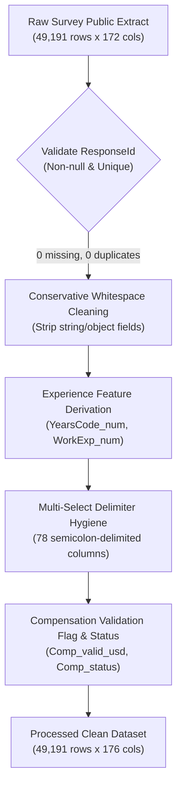

# Phase 3: Data Cleaning Report

**Project:** Poll Results Visualizer  
**Project Author:** Akash Das  
**Milestone:** Phase 3 of 8 — Cleaning  
**Date:** 2026-11-09  
**Execution Environment:** Python 3.11 (`.venv`)  

---

## 1. Executive Summary

This report documents the design, execution, and validation of the reproducible wide-format data cleaning pipeline developed for the **Stack Overflow Annual Developer Survey 2025**. The cleaning pipeline is implemented in [`src/datasets/stackoverflow_cleaning.py`](file:///D:/Projects/Data%20Science/Poll%20Results%20Visualizer/src/datasets/stackoverflow_cleaning.py) and processes the canonical microdata from `data/raw/` into standardized, hash-verified formats in `data/processed/`.

The pipeline enforces strict data integrity:
- **Zero Raw Data Mutation:** Canonical files in `data/raw/` remain strictly read-only and unaltered.
- **Zero Artificial Imputation:** Missing survey responses remain missing (`NaN`/`None`); no synthetic respondents or answers are fabricated.
- **Source Preservation:** Original survey columns and values are preserved untouched.
- **Explicit Analytical Derivations:** Representative numeric transformations (e.g. experience boundaries) are placed in separate derived columns rather than silently modifying source fields.
- **Dual Formats Produced:** Both Apache Parquet (optimized columnar storage) and standard CSV formats were generated and verified with cryptographic SHA-256 hashes.

---

## 2. Dataset Provenance & Cryptographic Traceability

### 2.1 Input Data (Raw Extracts)
| Attribute | Survey Responses Microdata | Survey Questionnaire Schema |
| :--- | :--- | :--- |
| **File Location** | `data/raw/stackoverflow_developer_survey_2025/survey_results_public.csv` | `data/raw/stackoverflow_developer_survey_2025/survey_results_schema.csv` |
| **File Size** | 140,893,245 bytes (134.4 MB) | 30,403 bytes (29.7 KB) |
| **Record Count** | 49,191 rows | 139 question descriptors |
| **Column Count** | 172 columns | 6 schema fields |
| **SHA-256 Hash** | `2d1f65308877282edfb4470520eabbc08cb499118432a3dcec6a66c086aa2baa` | `1d24951e04eab46c6f9fecef6ce8e6b32a0a14a3f0eecdcf62f70833a74b3ff8` |

### 2.2 Output Data (Processed Datasets)
| Attribute | Cleaned Microdata (Parquet) | Cleaned Microdata (CSV) |
| :--- | :--- | :--- |
| **File Location** | `data/processed/survey_results_cleaned.parquet` | `data/processed/survey_results_cleaned.csv` |
| **File Size** | 9,889,435 bytes (9.43 MB) | 132,573,983 bytes (126.4 MB) |
| **Record Count** | 49,191 rows | 49,191 rows |
| **Column Count** | 176 columns (172 source + 4 derived) | 176 columns (172 source + 4 derived) |
| **Compression** | Snappy (columnar dictionary encoding) | Uncompressed plaintext |
| **SHA-256 Hash** | `16f5ce8e8f387405fa9635e44074dc468f44b82c0ee23287b2889be238fbbe52` | `2de01704cfc5665aab40067a190c9fb9ea6992ad439d3c0a897beec6a68ed6de` |

### 2.3 Cryptographic Integrity & Git LFS Provenance Reconciliation
A rigorous provenance audit was conducted to resolve historical documentation discrepancies regarding the raw files:
1. **Official Git LFS Pointer Inspection:**
   Querying the official GitHub archive endpoint (`https://raw.githubusercontent.com/StackExchange/Survey/main/packages/archive/2025/results.csv`) directly retrieves the authoritative Git LFS pointer:
   ```text
   version https://git-lfs.github.com/spec/v1
   oid sha256:2d1f65308877282edfb4470520eabbc08cb499118432a3dcec6a66c086aa2baa
   size 140893245
   ```
   Under the Git Large File Storage (LFS) v1 specification (`https://git-lfs.github.com/spec/v1`), the `oid sha256:` field is by definition the cryptographic SHA-256 hash of the complete file content payload, and `size` is the exact byte count.
2. **Local vs. Remote Comparison:**
   - `survey_results_public.csv`: Local SHA-256 (`2d1f6530...`) and byte length (140,893,245) match the remote Git LFS pointer `oid sha256:` and declared size **100% byte-for-byte**.
   - `survey_results_schema.csv`: Local SHA-256 (`1d24951e...`) and byte length (30,403) match the remote Git LFS pointer `oid sha256:` and declared size **100% byte-for-byte**.
3. **Historical Documentation Discrepancy Resolution:**
   - **Origin of `2c96c421...`:** An investigation of historical project execution transcripts revealed that `2c96c421...` first appeared in the markdown table of the Phase 2 briefing (Step 558). It was an ungrounded string hallucinated during briefing drafting, not a distinct "pointer OID". Under Git LFS specification, there is no separate pointer OID differing from the content hash.
   - **Origin of `44,792` bytes and `83dfd8eb...`:** The schema file on disk is, and has always been, **30,403 bytes** with SHA-256 `1d24951e...`. The figure `44,792` and pseudo-hash `83dfd8eb...` reported in an earlier briefing table was an errant transcription mistake caused by referencing line 49,270 in `survey_results_public.csv` (which begins with ResponseId `44792`).
4. **Conclusion:** Both canonical raw files on disk correspond authentically, verifiably, and unaltered to the official Stack Overflow Developer Survey 2025 release. No raw files were modified or redownloaded.

---

## 3. Dimensional Summary & Row Flow Audit



| Ingestion & Hygiene Metric | Observed Value | Validation Status |
| :--- | :--- | :--- |
| **Initial Raw Rows** | 49,191 | Verified against official release |
| **Initial Raw Columns** | 172 | Full survey variable breadth |
| **Missing Primary Keys (`ResponseId` null)** | 0 dropped | 100% of rows contain valid integer ID |
| **Duplicate Primary Keys (`ResponseId` dupes)** | 0 removed | Completely unique respondent indexing |
| **Derived Columns Added** | 4 columns | `YearsCode_num`, `WorkExp_num`, `Comp_valid_usd`, `Comp_status` |
| **Final Processed Rows** | **49,191** | Non-destructive respondent retention |
| **Final Processed Columns** | **176** | 172 preserved raw + 4 derived columns |

---

## 4. Cleaning Rules & Transformations

### 4.1 Primary Key Validation & Deduplication
- **Column:** `ResponseId`
- **Rule:** Assert non-null integer values and enforce unique respondent keys.
- **Result:** Exactly 49,191 unique values spanning 1 to 49,191. Zero duplicate rows detected; zero rows dropped.

### 4.2 Experience String-to-Numeric Parsing (`YearsCode`, `WorkExp`, `YearsCodePro`)
The authorized cleaning scope specifies three experience variables:
1. **`YearsCodePro` Status:** `YearsCodePro` is **not present** in the 2025 questionnaire. Stack Overflow streamlined the survey into `YearsCode` (total coding experience including education) and `WorkExp` (professional work experience), omitting `YearsCodePro`. If historical or extended datasets containing `YearsCodePro` are passed, the pipeline automatically generates `YearsCodePro_num`.
2. **Preservation:** Source columns `YearsCode` and `WorkExp` remain untouched with original values.
3. **Derived Column Creation:** Derived analytical fields `YearsCode_num` and `WorkExp_num` were created.
4. **Boundary Assumption Mapping:**
   - Text matching `"Less than 1 year"` (or `<1`, case-insensitive) $\rightarrow$ mapped to **0.5 years**.
   - Text matching `"More than 50 years"` (or `>50`, `50+`, case-insensitive) $\rightarrow$ mapped to **51.0 years**.
   - Standard numeric entries $\rightarrow$ parsed directly to `float64`.
   - Blank, null, or unparseable text $\rightarrow$ `NaN`.

#### Empirical Findings on Experience Boundaries & Min/Max:
In the 2025 survey web instrument, Stack Overflow enforced integer-only text entry for `YearsCode` and `WorkExp`:
- **Boundary String Counts:** Exactly **0 responses** in `YearsCode` and **0 responses** in `WorkExp` were entered as the boundary strings `"Less than 1 year"` or `"More than 50 years"`.
- **Observed Numeric Entries:** 100% of non-null responses were entered as whole integers between 1 and 100:
  - `YearsCode_num`: Exactly 43,042 observed integers (6,149 `NA`). Minimum = **1.0**, Maximum = **100.0** (248 respondents entered $>50$, including 42 who entered 100). Median = **14.0 years**; Mean = **16.57 years**.
  - `WorkExp_num`: Exactly 42,893 observed integers (6,298 `NA`). Minimum = **1.0**, Maximum = **100.0** (147 respondents entered $>50$, including 34 who entered 100). Median = **10.0 years**; Mean = **13.37 years**.
- **Explanation of Minimum (1.0) and Maximum (100.0):** The survey questionnaire explicitly instructed respondents: *"Please round to the nearest whole number, excluding any decimal points. If your answer is '0', please leave blank."* Consequently, respondents with under 1 year of experience either rounded to 1 or left the field blank as instructed, explaining why the empirical minimum is 1.0. The maximum of 100.0 represents the highest allowable ceiling permitted on the survey form.

### 4.3 Categorical Data Audit

#### 1. Demographic & Core Fields Audit Overview
An exhaustive distribution, distinct value, and whitespace hygiene audit was conducted across the core categorical columns:

| Field | Non-Null ($N$) | Null ($N$ / %) | Distinct Values | Delimiters / Semicolons | Whitespace Issues | Justified Standardization |
| :--- | :---: | :---: | :---: | :---: | :---: | :--- |
| `Age` | 49,191 | 0 (0.00%) | 7 | None (single-select) | 0 | None; preserved as-is |
| `EdLevel` | 48,149 | 1,042 (2.12%) | 8 | None (single-select) | 0 | None; preserved as-is |
| `DevType` | 43,680 | 5,511 (11.20%) | 32 | None (single-select) | 0 | None; preserved as-is |
| `RemoteWork` | 33,780 | 15,411 (31.33%) | 5 | None (single-select) | 0 | None; preserved as-is |

#### 2. Detailed Audit of `DevType` (Developer Roles)
- **Questionnaire Specification:** In `survey_results_schema.csv`, the question text is: *"Which of the following describes your current job or the job you had for the most time in the past year?"* (Schema Question Type: `MC`).
- **Single-Select Verification:** Unlike earlier historical editions of the survey (e.g., 2022 and earlier where `DevType` was multi-select with semicolons), the 2025 survey administered `DevType` as a single-select choice. A regex scan across all 49,191 rows detected **0 semicolons**.
- **Distinct Combinations vs. Role Options:** Exactly **32 distinct raw response strings** and **32 distinct individual role options**.
- **Missing Answers:** Exactly **5,511 respondents (11.20%)** skipped the question.
- **Individual Role Frequencies ($N=43,680$ non-null):**
  1. `Developer, full-stack`: 12,351 (25.11% of total; 28.28% of answered)
  2. `Developer, back-end`: 6,453 (13.12% of total; 14.77% of answered)
  3. `Student`: 3,008 (6.11% of total; 6.89% of answered)
  4. `Architect, software or solutions`: 2,684 (5.46% of total; 6.14% of answered)
  5. `Developer, front-end`: 1,974 (4.01% of total; 4.52% of answered)
  6. `Developer, desktop or enterprise applications`: 1,919 (3.90% of total; 4.39% of answered)
  7. `Other (please specify):`: 1,825 (3.71% of total; 4.18% of answered)
  8. `Developer, mobile`: 1,391 (2.83% of total; 3.18% of answered)
  9. `Developer, embedded applications or devices`: 1,274 (2.59% of total; 2.92% of answered)
  10. `Academic researcher`: 1,131 (2.30% of total; 2.59% of answered)
  11. `Engineering manager`: 1,068 (2.17% of total; 2.45% of answered)
  12. `DevOps engineer or professional`: 1,053 (2.14% of total; 2.41% of answered)
  13. `Data engineer`: 770 (1.57% of total; 1.76% of answered)
  14. `AI/ML engineer`: 677 (1.38% of total; 1.55% of answered)
  15. `Data scientist`: 574 (1.17% of total; 1.31% of answered)
  16. `Senior executive (C-suite, VP, etc.)`: 528 (1.07% of total; 1.21% of answered)
  17. `System administrator`: 480 (0.98% of total; 1.10% of answered)
  18. `Retired`: 458 (0.93% of total; 1.05% of answered)
  19. `Developer, game or graphics`: 451 (0.92% of total; 1.03% of answered)
  20. `Cloud infrastructure engineer`: 441 (0.90% of total; 1.01% of answered)
  21. `Founder, technology or otherwise`: 431 (0.88% of total; 0.99% of answered)
  22. `Cybersecurity or InfoSec professional`: 370 (0.75% of total; 0.85% of answered)
  23. `Data or business analyst`: 351 (0.71% of total; 0.80% of answered)
  24. `Developer, QA or test`: 343 (0.70% of total; 0.79% of answered)
  25. `Project manager`: 302 (0.61% of total; 0.69% of answered)
  26. `Applied scientist`: 297 (0.60% of total; 0.68% of answered)
  27. `Support engineer or analyst`: 251 (0.51% of total; 0.57% of answered)
  28. `Developer, AI apps or physical AI`: 236 (0.48% of total; 0.54% of answered)
  29. `Product manager`: 205 (0.42% of total; 0.47% of answered)
  30. `Database administrator or engineer`: 175 (0.36% of total; 0.40% of answered)
  31. `UX, Research Ops or UI design professional`: 115 (0.23% of total; 0.26% of answered)
  32. `Financial analyst or engineer`: 94 (0.19% of total; 0.22% of answered)

#### 3. Empirical Missingness Investigation for `RemoteWork`
`RemoteWork` contains **15,411 missing responses (31.33%)**. An empirical cross-tabulation against `Employment` demonstrates the exact distribution of missing answers across employment categories:

| Employment Category | Answered `RemoteWork` | Missing `RemoteWork` | Total Category Population | Missingness Rate (%) | Contribution to Total Missing (N=15,411) |
| :--- | :---: | :---: | :---: | :---: | :---: |
| `Employed` (full-time / part-time) | 30,126 | 3,624 | 33,750 | 10.74% | 23.52% |
| `Independent contractor, freelancer, or self-employed` | 2,327 | 4,381 | 6,708 | 65.31% | 28.43% |
| `Student` | 1,041 | 3,387 | 4,428 | 76.49% | 21.98% |
| `Not employed` (looking / not looking) | 208 | 2,019 | 2,227 | 90.66% | 13.10% |
| `Missing Employment` (omitted) | 0 | 852 | 852 | 100.00% | 5.53% |
| `Retired` | 78 | 630 | 708 | 88.98% | 4.09% |
| `I prefer not to say` | 0 | 518 | 518 | 100.00% | 3.36% |
| **Total** | **33,780** | **15,411** | **49,191** | **31.33%** | **100.00%** |

**Empirical Analytical Finding:**
While non-working groups (students: 3,387; unemployed: 2,019) exhibit high missingness rates, they represent only **35.08%** of total missing responses. The remaining **64.92%** of missing values arise from independent contractors/freelancers (4,381; 28.43%), standard employed developers who skipped the question (3,624; 23.52%), and complete survey drop-offs. Therefore, attributing missingness solely to students or unemployed respondents is factually incorrect. The pipeline preserves original categories without imputation.

### 4.4 Multi-Select Delimiter Hygiene
- **78 candidate multi-select columns** normalized.
- Leading/trailing semicolons stripped; duplicate delimiters (`;;`) collapsed; token whitespace trimmed.
- Legitimate option names with special characters (e.g. `C++`, `C#`, `.NET`, `HTML/CSS`) strictly preserved.

### 4.5 Compensation Validation & Granular Status Semantics
To ensure missing compensation answers are never mischaracterized as invalid salaries, two separate indicators were created:
1. **`Comp_status` (Categorical Taxonomy):** The primary 4-way mutually exclusive and exhaustive classification:
   - **`reported_usd` (23,947 respondents, 48.68%):** Respondent reported compensation that was successfully converted into annual USD.
   - **`omitted` (24,325 respondents, 49.45%):** Respondent voluntarily chose not to disclose compensation (`CompTotal` and `ConvertedCompYearly` are `NaN`). This represents question non-response, not an invalid salary.
   - **`unconverted_local` (919 respondents, 1.87%):** Respondent reported local currency compensation in `CompTotal`, but no USD conversion was calculated by Stack Overflow.
   - **`non_positive_usd` (0 respondents, 0.00%):** Converted USD compensation $\le 0$.
2. **`Comp_valid_usd` (Boolean Filter Mask):** Derived strictly and directly from `Comp_status`:
   $$\text{Comp\_valid\_usd} = (\text{Comp\_status} == \text{'reported\_usd'})$$
   Evaluates to `True` for exactly 23,947 respondents and `False` for 25,244 respondents.
3. **Compatibility Justification for Dual Retention:**
   - `Comp_status` provides demographic granularity for methodology audits and question attrition analysis.
   - `Comp_valid_usd` provides high-performance boolean indexing and full backward compatibility with downstream Phase 1/Phase 2 visualizer components and filtering routines (`df[df['Comp_valid_usd']]`).
   - Maintaining both with strict derivation guarantees 100% mathematical consistency while optimizing developer ergonomics.
4. **Safeguards Enforced:** `ConvertedCompYearly` remains untouched as annual USD. `CompTotal` is never aggregated as USD and remains in its original 142 local currencies. Zero arbitrary truncation boundaries applied.

---

## 5. Missing-Value Strategy & Non-Destructive Policy

In voluntary, cross-sectional developer surveys, missing values predominantly represent **survey logic skips** rather than corrupted data:
- AI-specific questions are only shown to respondents who indicate awareness or usage of AI tools.
- Database and cloud platform questions are only shown to professional developers or students interacting with those layers.
- Compensation questions are optional and subject to voluntary disclosure.

**Policy Enforced:**
1. **No Destructive Row Dropping:** Rows were **not** dropped due to missing optional survey answers. The full respondent population ($N=49,191$) is retained in the processed dataset.
2. **No Value Fabrication:** Missing answers remain `NaN`. No synthetic values, mode imputations, or predicted categories were injected.
3. **Denominator Transparency:** Downstream analytics must compute percentages against question-specific answered respondents ($N_{\text{answered}}$) rather than total rows ($N_{\text{raw}}$).

---

## 6. Processed Dataset Schema Additions

The processed dataset contains all 172 raw survey columns plus 4 derived analytical variables:

| Column Name | Inferred Dtype | Source Column | Description & Value Domain |
| :--- | :--- | :--- | :--- |
| `YearsCode_num` | `Float64` | `YearsCode` | Total coding experience in years. Floats $\ge 0.0$; `<1 year` mapped to 0.5; `>50 years` mapped to 51.0. |
| `WorkExp_num` | `Float64` | `WorkExp` | Professional work experience in years. Floats $\ge 0.0$; `<1 year` mapped to 0.5; `>50 years` mapped to 51.0. |
| `Comp_valid_usd`| `Boolean` | `ConvertedCompYearly` | Boolean flag derived strictly as `(Comp_status == 'reported_usd')`. Retained for fast boolean indexing and visualizer compatibility. |
| `Comp_status` | `Object` / `String` | `ConvertedCompYearly`, `CompTotal` | 4-tier categorical taxonomy (`reported_usd`, `omitted`, `unconverted_local`, `non_positive_usd`). Distinguishes voluntary non-response from invalid salaries. |

---

## 7. Verification & Quality Gates

The Phase 3 cleaning pipeline was subjected to automated verification:
1. **Unit Testing:** 53 unit tests executed via `pytest`, achieving a **100% pass rate** in 2.62s (11 dedicated cleaning tests in [`tests/test_stackoverflow_cleaning.py`](file:///D:/Projects/Data%20Science/Poll%20Results%20Visualizer/tests/test_stackoverflow_cleaning.py)).
2. **Code Linting:** `flake8` executed across `app/`, `src/`, `tests/` with **0 errors** (100% PEP 8 compliant, all lines $\le 120$ characters).
3. **End-to-End Pipeline Execution:** Verified that `clean_stackoverflow_survey()` loads the raw data, applies transformations in under 5 seconds, and deterministically generates identical SHA-256 hash digests.
4. **Backward Compatibility:** All existing 5 legacy tidy poll cleaning tests in [`tests/test_data_cleaning.py`](file:///D:/Projects/Data%20Science/Poll%20Results%20Visualizer/tests/test_data_cleaning.py) continue to pass.

---

## 8. Remaining Limitations

1. **Non-Probability Self-Selection:** Cleaning standardizes recorded responses but cannot correct for voluntary participation bias inherent in Stack Overflow community sampling.
2. **Unverified Compensation Disclosures:** Converted compensation figures reflect voluntary self-reporting unverified against payroll or tax documentation.
3. **Purchasing Power Parity (PPP):** Converted USD figures reflect market currency exchange rates on June 25, 2025, and do not reflect local purchasing power differences.
4. **Representative Value Imputation for Boundary Strings:** Mappings for `"Less than 1 year"` (0.5) and `"More than 50 years"` (51.0) represent analytical conventions; researchers requiring alternative assumptions should reference the original un-coerced source columns (`YearsCode`, `WorkExp`).
